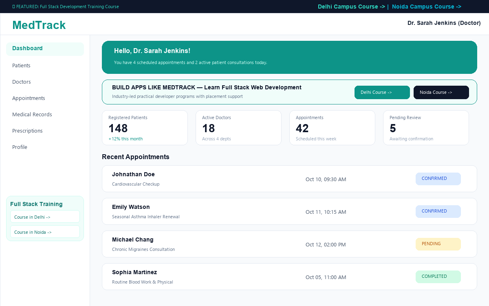
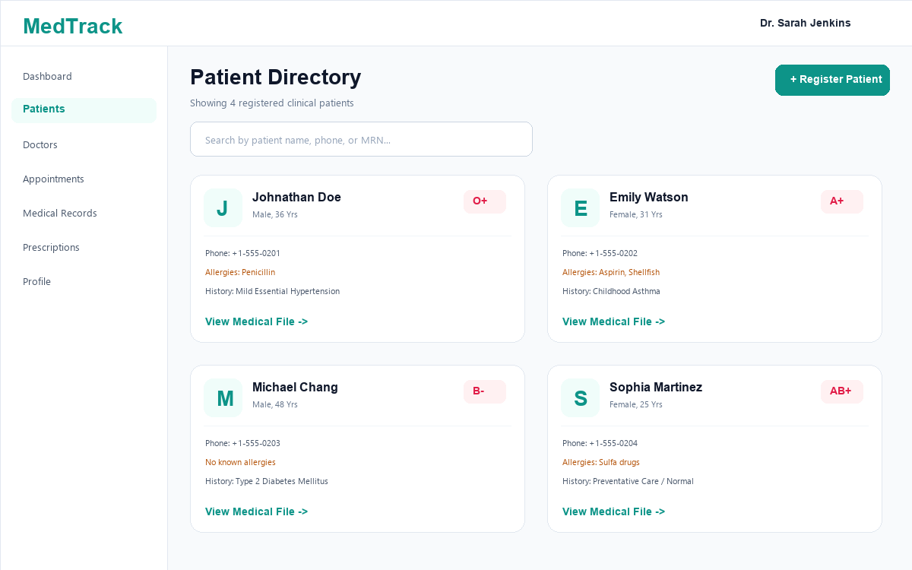
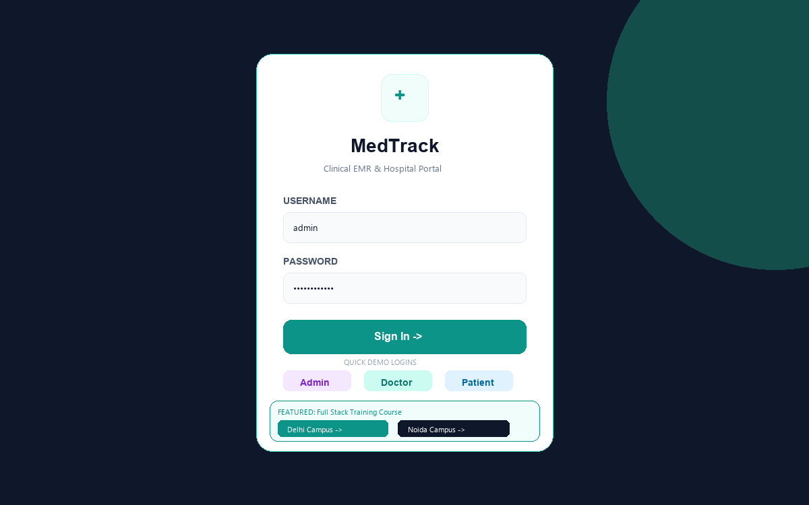
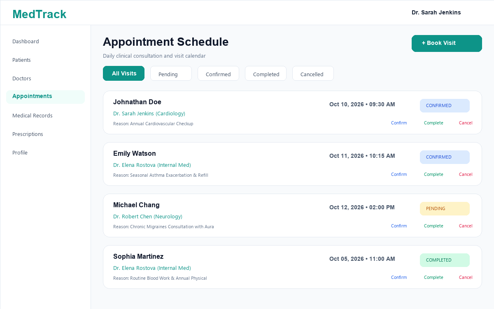
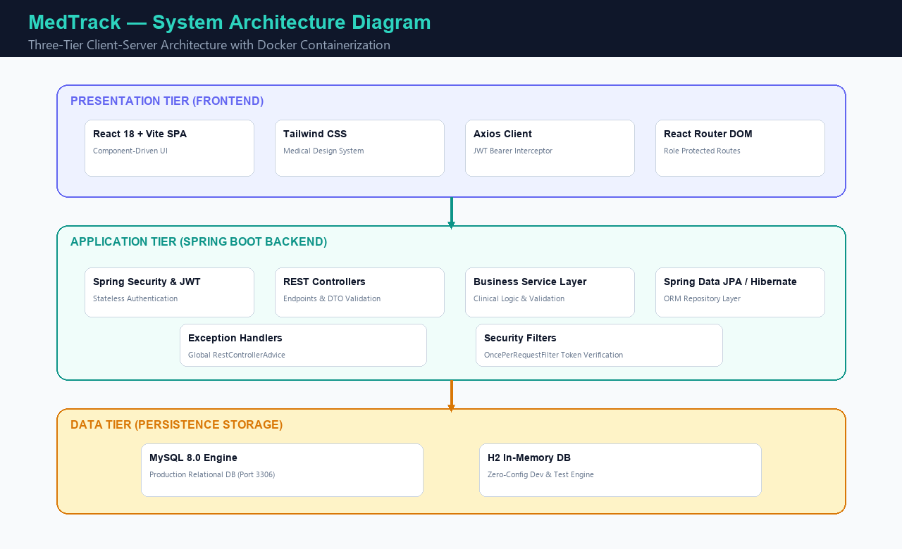
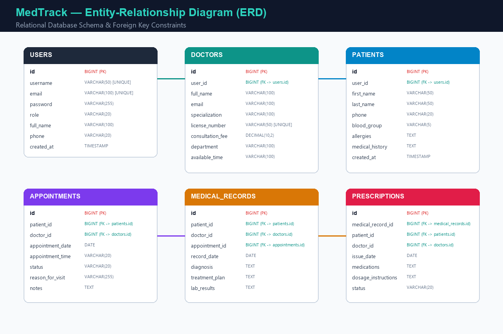

# 🏥 MedTrack — Hospital & Patient Management System

[](https://openjdk.org/)
[](https://spring.io/projects/spring-boot)
[](https://react.dev/)
[](https://vitejs.dev/)
[](https://tailwindcss.com/)
[](LICENSE)

**MedTrack** is a clinical-grade, full-stack hospital and patient management web application. It delivers role-based access control (RBAC), electronic medical records (EMR), doctor consultation scheduling, electronic prescription tracking, and real-time administrative analytics.

---

## 📸 Screenshots & Architecture

| Portal Dashboard | Patient Directory |
| :---: | :---: |
|  |  |

| Secure Authentication | Appointment Scheduler |
| :---: | :---: |
|  |  |

| System Architecture | Entity Relationship Diagram |
| :---: | :---: |
|  |  |

---

## 🗂️ Project Directory Structure

```text
MedTrack/
├── README.md                          # Project documentation and setup guide
├── .gitignore                         # Git ignore configuration
├── LICENSE                            # MIT License
├── docker-compose.yml                 # Multi-container orchestration (MySQL + Backend + Frontend)
│
├── backend/                           # Spring Boot 3 REST API
│   ├── pom.xml                        # Maven dependencies & build plugins
│   ├── Dockerfile                     # Multi-stage Docker build for backend
│   ├── mvnw / mvnw.cmd                # Maven Wrapper executables
│   └── src/
│       ├── main/
│       │   ├── java/com/medtrack/
│       │   │   ├── MedTrackApplication.java
│       │   │   ├── config/            # SecurityConfig, CorsConfig, JwtConfig
│       │   │   ├── controller/        # Auth, Patient, Doctor, Appointment, EMR, Rx, Admin
│       │   │   ├── service/           # Business logic service implementations
│       │   │   ├── repository/        # Spring Data JPA repositories
│       │   │   ├── entity/            # JPA entities (User, Patient, Doctor, Appointment, etc.)
│       │   │   ├── dto/               # Request/Response Data Transfer Objects
│       │   │   ├── security/          # JwtService, JwtAuthenticationFilter, UserDetailsService
│       │   │   ├── exception/         # GlobalExceptionHandler, ResourceNotFoundException
│       │   │   └── util/              # DateUtil and helper formatters
│       │   └── resources/
│       │       ├── application.properties
│       │       └── data.sql           # Database seed script
│
├── frontend/                          # React 18 + Vite SPA
│   ├── package.json                   # Dependencies (React, Vite, Tailwind, Axios, Lucide)
│   ├── vite.config.js                 # Vite build & reverse-proxy config
│   ├── tailwind.config.js             # Medical color palette & design tokens
│   ├── Dockerfile                     # Nginx + production bundle container
│   ├── nginx.conf                     # Production reverse proxy config
│   └── src/
│       ├── main.jsx                   # React entrypoint
│       ├── App.jsx                    # Routing & layout configuration
│       ├── components/                # Navbar, Sidebar, PatientCard, AppointmentCard, ProtectedRoute
│       ├── pages/                     # Login, Register, Dashboard, Patients, Doctors, etc.
│       ├── services/                  # Axios API integrations
│       ├── context/                   # AuthContext state provider
│       ├── hooks/                     # Custom useAuth hook
│       └── utils/                     # Constants, status dictionaries
│
├── database/                          # Database definitions
│   ├── schema.sql                     # Full MySQL DDL schema
│   └── sample-data.sql                # Seed clinical dataset
│
├── docs/                              # Project design documents
│   ├── ER-Diagram.png                 # Entity-Relationship diagram
│   ├── API-Documentation.md           # REST API endpoints & payload specifications
│   └── System-Architecture.png        # High-level architecture diagram
│
└── screenshots/                       # High-resolution application screenshots
    ├── login.png
    ├── dashboard.png
    ├── patients.png
    └── appointments.png
```

---

## 🚀 Quick Start Guide

### Prerequisites
- **Java**: 17 or higher
- **Node.js**: v18 or higher (v20+ recommended)
- **Maven**: Optional (bundled `./mvnw` / `mvnw.cmd` included)
- **Docker & Docker Compose**: (Optional, for containerized run)

---

### Method 1: Running Locally (Development Mode)

#### 1. Start Backend (Spring Boot)
The backend comes pre-configured with zero-configuration in-memory H2 database (with automatic seeding), so you do not need MySQL to get started immediately.

```bash
cd backend

# On Windows:
.\mvnw.cmd spring-boot:run

# On Linux/macOS:
./mvnw spring-boot:run
```

- API Base URL: `http://localhost:8080/api`
- H2 Console: `http://localhost:8080/h2-console` (JDBC URL: `jdbc:h2:mem:medtrack_db`, User: `sa`, Password: *empty*)

#### 2. Start Frontend (React + Vite)
Open a separate terminal:

```bash
cd frontend
npm install
npm run dev
```

- Web Portal: `http://localhost:5173`

---

### Method 2: Running with Docker Compose

To spin up the full production stack with MySQL 8.0, Spring Boot backend, and Nginx frontend in isolated containers:

```bash
docker-compose up --build
```

- Frontend Web Application: `http://localhost:3000`
- Backend API: `http://localhost:8080/api`
- MySQL Database: `localhost:3306`

---

## 🔑 Default Demo Accounts

| Role | Username | Password | Access Capabilities |
| :--- | :--- | :--- | :--- |
| **System Admin** | `admin` | `password123` | Full administrative control, user & doctor management, clinic KPIs |
| **Doctor** | `dr.sarah` | `password123` | Manage patients, schedule visits, issue prescriptions, EMR entries |
| **Doctor** | `dr.robert` | `password123` | Neurology consultations, medical diagnoses |
| **Patient** | `john.doe` | `password123` | Patient portal, personal medical history, view prescriptions |

*(Quick demo buttons are also provided directly on the Login screen for 1-click access!)*

---

## 🛡️ Security & Authentication

- **Stateless JWT**: Standard Bearer tokens generated with HMAC-SHA256 (`jjwt 0.12.5`).
- **Password Hashing**: BCrypt with salted rounds.
- **RBAC**: Enforced at method and URL levels via Spring Security `@PreAuthorize("hasRole('ADMIN')")`.
- **CORS Support**: Permitted origin whitelist for frontend clients.

---

## 📚 API Endpoints Summary

See full documentation in [docs/API-Documentation.md](docs/API-Documentation.md).

- `POST /api/auth/login` — Authenticate and receive JWT
- `POST /api/auth/register` — Register new user account
- `GET /api/patients` — List & search patients
- `POST /api/patients` — Register new patient
- `GET /api/doctors` — List medical specialists
- `GET /api/appointments` — View scheduled appointments
- `POST /api/appointments` — Schedule a new appointment
- `PATCH /api/appointments/{id}/status` — Update visit status (`CONFIRMED`, `COMPLETED`, `CANCELLED`)
- `GET /api/medical-records` — List electronic medical records
- `POST /api/prescriptions` — Prescribe medications

---

## 🎓 Recommended Full Stack Development Training

Want to learn how to build production-grade full-stack systems like MedTrack from scratch? Check out comprehensive training programs:
- 📍 **[Full Stack Development Training Course in Delhi](https://uncodemy.com/course/full-stack-development-training-course-in-delhi)** — Practical training with industry capstone projects & mentorship.
- 📍 **[Full Stack Development Training Course in Noida](https://uncodemy.com/course/full-stack-development-training-course-in-noida)** — Hands-on developer certification with career support.

---

## 📄 License

This project is licensed under the MIT License - see the [LICENSE](LICENSE) file for details.
